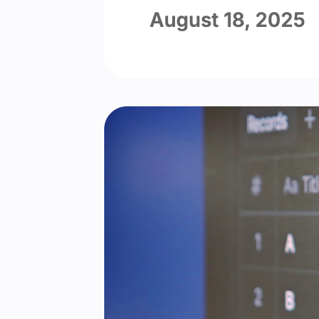

import { Tab, Tabs } from 'fumadocs-ui/components/tabs'

Squircle 圆角把所有圆角做成 Squircle，而不是圆弧，带来现代而流畅的观感。

<Tabs items={['启用 Squircle 圆角', '禁用 Squircle 圆角']}>
  <Tab value="启用 Squircle 圆角">
    
  </Tab>
  <Tab value="禁用 Squircle 圆角">
    
  </Tab>
</Tabs>

由于 Squircle 圆角使用 `@support` 来确保兼容性，它默认启用。

```yml title="_config.cupertino.yml"
squircle: true
```
